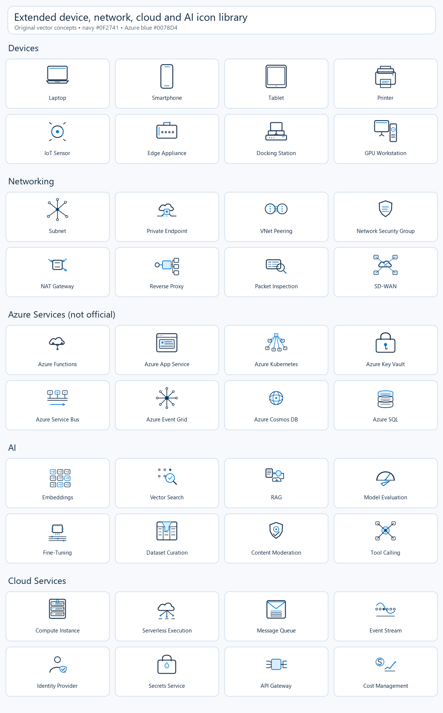

# Affinity Community Icons

Original minimalist vector icons for device management, networking, cloud,
AI, security, and document sections. Created in Affinity Studio and shared
with the community under the [Apache License 2.0](LICENSE).

**Version 2.1.1** includes **100 SVG icons**, matching PNG exports, **9 editable
Affinity documents**, and preview sheets. The original 48 infrastructure icons
are distinct designs; security entries include color and usage variants rather
than additional distinct concepts.

> **Not official Azure icons:** Azure-related illustrations in this collection
> are independent, original conceptual symbols, not Microsoft's official Azure
> service icons or product logos. They do not imply Microsoft endorsement.

## Download and use

Download the repository ZIP from **Code > Download ZIP**, or clone it:

```powershell
git clone https://github.com/robgrame/affinity-community-icons.git
```

The native `.af` documents are stored directly in Git: no Git LFS
client or separate binary download is required. Open them in a compatible
version of Affinity Studio (created with Affinity 3.3). Use SVG for scalable
UI, presentations and print; PNG is convenient for applications that do not
support SVG. Keep the original proportions and recolor both fills and strokes.

## Collections

| Collection | SVG variants | Native documents | Artwork and preview |
|---|---:|---:|---|
| [Infrastructure 01](sets/infrastructure-01) | 16 | 1 | Device management, inventory, compliance, deployment; topology, wireless, internet, firewall; services, upload, security, hybrid cloud; processor, neural network, assistant, automation |
| [Infrastructure 02](sets/infrastructure-02) | 16 | 1 | Remote support, updates, diagnostics, power; switch, VPN, Ethernet, load balancing; storage, backup, database, multi-region; model, data pipeline, prompt, insights |
| [Infrastructure 03](sets/infrastructure-03) | 16 | 1 | Policy, encryption, enrollment, lifecycle; DNS, latency, routing, gateway; containers, autoscaling, monitoring, recovery; agents, vision, knowledge, guardrails |
| [Section icons](sets/section-icons) | 4 | 2 | Challenge shield and lock, outcome trace, capability checklist, ascending-bar alternative |
| [Security: lock and magnifier](sets/security-lock-magnifier) | 4 | 1 | Navy outline, Azure outline, solid Azure and solid monochrome |
| [Security: solid Azure exports](sets/security-solid-azure) | 4 | 2 | Light, dark and white-lock variants, plus SVG/ICO favicon and multiple PNG sizes |
| [Extended services and infrastructure](sets/extended-services) | 40 | 1 | 8 each for Devices, Networking, Azure Services, AI workflows, and Cloud Services |

### Infrastructure 01


### Infrastructure 02


### Infrastructure 03


### Section icons


SFIDA means "challenge"; the shield has an unfilled outline and a centered
padlock. OUTCOME includes an off-white vector grid. The checklist is the
preferred FEATURES icon; the original bar chart is retained as an alternative.
The v1.1.3 native document contains all four artboards; v1.0.2 preserves the
first three designs.

### Security: lock and magnifier

| Navy outline | Azure outline | Solid Azure | Solid monochrome |
|---|---|---|---|
|  |  |  |  |

### Security: solid Azure exports


Portal PNG sizes: 32, 40, 48, 64, 256 and 512 px for each light/dark/white
variant. Favicon PNGs: 16, 32, 48, 64, 128 and 256 px, plus a multi-image ICO.
The native v1.1.4 document includes the white-lock artboard; v1.1.3 is retained
as an earlier version.

## Design

The infrastructure sets use 256 x 256 px transparent artboards, arranged in
a 4 x 4 grid per native document. The shared palette is navy **#0F2741** and
Azure blue **#0078D4**, with rounded 8 px strokes. Recommended display size:
32 px or larger; use 48 px for detail-heavy icons. Light-colored security
variants are intended for dark backgrounds.
The extended collection adds a single 40-artboard document to the three
original 16-artboard infrastructure documents.

All icon SVGs contain vector geometry rather than embedded raster artwork
or font-dependent labels. Preview sheets are raster images with labels.
The [catalog](catalog.json) records every distributed asset's SHA-256 hash,
size and relative path for integrity checks.

## Extended services and infrastructure icons

The [Affinity Studio document](sets/extended-services/Extended-Cloud-Device-Network-AI-Services-v1.0.1.af)
contains **40 artboards**, arranged as five ordered groups of eight. Each design
uses editable vector geometry, a transparent 256 x 256 px canvas, and the
existing navy/Azure palette. SVGs and transparent 256 px PNGs are provided for
each icon, along with individual category previews and a combined contact sheet.

> **Azure Services artwork is not official.** The eight Azure-labeled concepts
> are independent, original illustrations; they do not use or reproduce
> Microsoft's official Azure service icons or logos and do not imply endorsement.

| Collection | Icons |
|---|---|
| [Devices](sets/extended-services/devices-preview.png) | [Laptop](sets/extended-services/01-laptop.svg), [Smartphone](sets/extended-services/02-smartphone.svg), [Tablet](sets/extended-services/03-tablet.svg), [Printer](sets/extended-services/04-printer.svg), [IoT sensor](sets/extended-services/05-iot-sensor.svg), [Edge appliance](sets/extended-services/06-edge-appliance.svg), [Docking station](sets/extended-services/07-docking-station.svg), [GPU workstation](sets/extended-services/08-gpu-workstation.svg) |
| [Networking](sets/extended-services/networking-preview.png) | [Subnet](sets/extended-services/09-subnet.svg), [Private endpoint](sets/extended-services/10-private-endpoint.svg), [VNet peering](sets/extended-services/11-vnet-peering.svg), [Network security group](sets/extended-services/12-network-security-group.svg), [NAT gateway](sets/extended-services/13-nat-gateway.svg), [Reverse proxy](sets/extended-services/14-reverse-proxy.svg), [Packet inspection](sets/extended-services/15-packet-inspection.svg), [SD-WAN](sets/extended-services/16-sd-wan.svg) |
| [Azure Services — unofficial concepts](sets/extended-services/azure-services-preview.png) | [Functions](sets/extended-services/17-azure-functions.svg), [App Service](sets/extended-services/18-azure-app-service.svg), [Kubernetes](sets/extended-services/19-azure-kubernetes.svg), [Key Vault](sets/extended-services/20-azure-key-vault.svg), [Service Bus](sets/extended-services/21-azure-service-bus.svg), [Event Grid](sets/extended-services/22-azure-event-grid.svg), [Cosmos DB](sets/extended-services/23-azure-cosmos-db.svg), [SQL](sets/extended-services/24-azure-sql.svg) |
| [AI workflows](sets/extended-services/ai-workflows-preview.png) | [Embeddings](sets/extended-services/25-embeddings.svg), [Vector search](sets/extended-services/26-vector-search.svg), [RAG](sets/extended-services/27-retrieval-augmented-generation.svg), [Model evaluation](sets/extended-services/28-model-evaluation.svg), [Fine-tuning](sets/extended-services/29-fine-tuning.svg), [Dataset curation](sets/extended-services/30-dataset-curation.svg), [Content moderation](sets/extended-services/31-content-moderation.svg), [Tool calling](sets/extended-services/32-tool-calling.svg) |
| [Cloud Services](sets/extended-services/cloud-services-preview.png) | [Compute instance](sets/extended-services/33-compute-instance.svg), [Serverless execution](sets/extended-services/34-serverless-execution.svg), [Message queue](sets/extended-services/35-message-queue.svg), [Event stream](sets/extended-services/36-event-stream.svg), [Identity provider](sets/extended-services/37-identity-provider.svg), [Secrets service](sets/extended-services/38-secrets-service.svg), [API gateway](sets/extended-services/39-api-gateway.svg), [Cost management](sets/extended-services/40-cost-management.svg) |



Use these icons to illustrate general architecture concepts. For a diagram
requiring official Azure service artwork, download it separately from the
[official Microsoft icon collection](https://learn.microsoft.com/en-us/azure/architecture/icons/);
those official assets are not bundled here.

## Contributing

Issues and pull requests are welcome. Include a descriptive icon name, an
SVG export and a preview, and keep editable Affinity source when available.
Follow the existing palette and proportions, or clearly identify intentional
alternatives. Contribute only original artwork or work you have permission to
redistribute. Do not include credentials, private documents or personal data.

Versions use **Major.Minor.Build**. Increment Build for each change, Minor for
a new collection or significant capability, and Major for breaking changes.

## License

The artwork is distributed under the [Apache License 2.0](LICENSE). Follow
its notice and attribution requirements when redistributing the artwork.
Copyright and license notices remain applicable independently of asset names.

Asset filenames and native document titles are generic. Version 2.0.2 removed
product-specific references and renamed assets without changing their icon
geometry; update old links to the paths in the current catalog.

Service and company names are descriptive only. No official Microsoft Azure,
Affinity or Canva badges are reproduced, and no endorsement or trademark
rights are granted.
