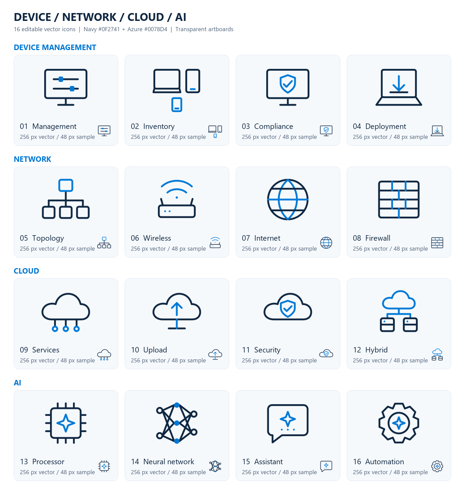
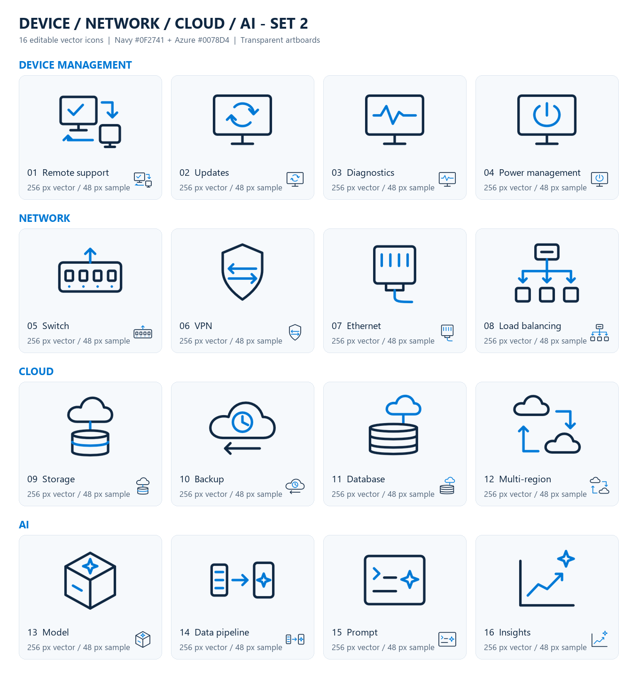
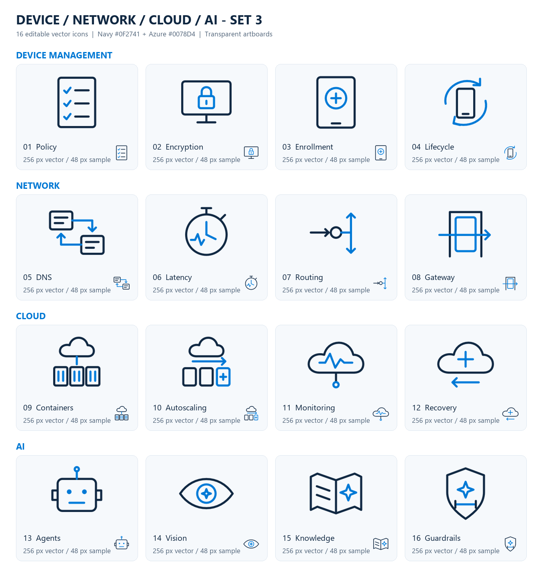
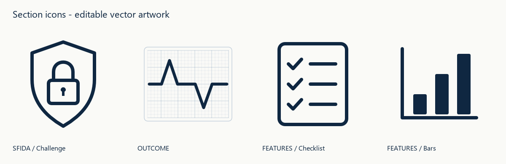
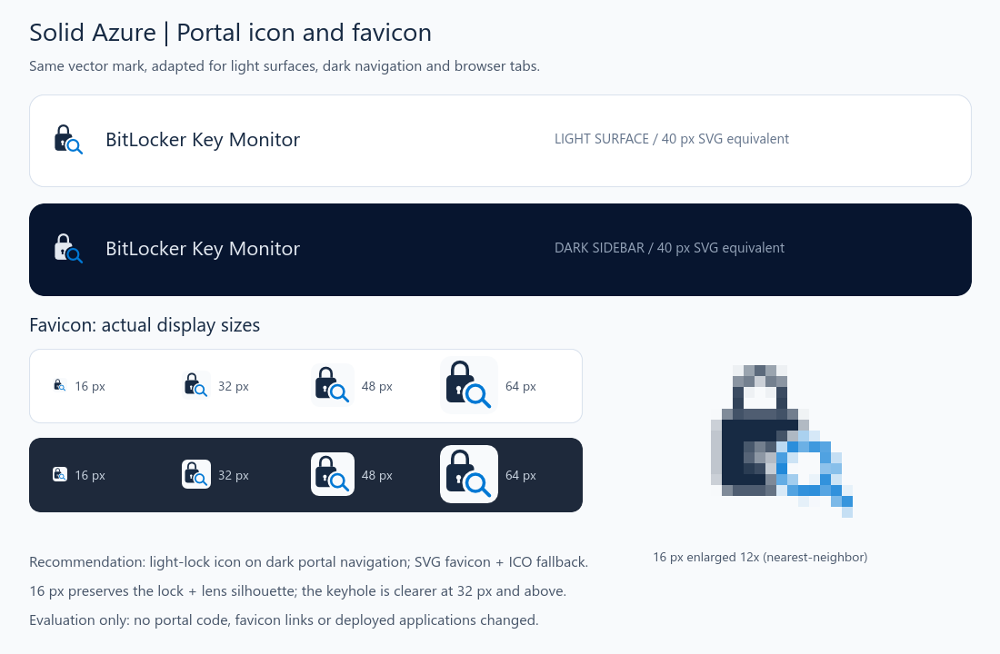

# Affinity Community Icons

Original minimalist vector icons for device management, networking, cloud,
AI, security, and document sections. Created in Affinity Studio and shared
with the community under the [Apache License 2.0](LICENSE).

**Version 1.0.1** includes **60 SVG variants**, matching PNG exports where
available, **8 editable Affinity documents**, and preview sheets. The 48
infrastructure icons are different designs; security entries include color
and usage variants, not 60 distinct concepts.

## Download and use

Download the repository ZIP from **Code > Download ZIP**, or clone it:

```powershell
git clone https://github.com/robgrame/affinity-community-icons.git
```

The small native `.af` documents are stored directly in Git: no Git LFS
client or separate binary download is required. Open them in a compatible
version of Affinity Studio (created with Affinity 3.3). Use SVG for scalable
UI, presentations and print; PNG is convenient for applications that do not
support SVG. Keep the original proportions and recolor both fills and strokes.

## Collections

| Collection | SVG variants | Native documents | Artwork and preview |
|---|---:|---:|---|
| [Infrastructure 01](sets/infrastructure-01) | 16 | 1 | Device management, inventory, compliance, deployment; topology, wireless, internet, firewall; services, upload, security, hybrid cloud; processor, neural network, assistant, automation |
| [Infrastructure 02](sets/infrastructure-02) | 16 | 1 | Remote support, updates, diagnostics, power; switch, VPN, Ethernet, load balancing; storage, backup, database, multi-region; model, data pipeline, prompt, insights |
| [Infrastructure 03](sets/infrastructure-03) | 16 | 1 | Policy, encryption, enrollment, lifecycle; DNS, latency, routing, gateway; containers, autoscaling, monitoring, recovery; agents, vision, knowledge, guardrails |
| [Section icons](sets/section-icons) | 4 | 2 | Challenge shield and lock, outcome trace, capability checklist, ascending-bar alternative |
| [Security: lock and magnifier](sets/security-lock-magnifier) | 4 | 1 | Navy outline, Azure outline, solid Azure and solid monochrome |
| [Security: solid Azure exports](sets/security-solid-azure) | 4 | 2 | Light, dark and white-lock variants, plus SVG/ICO favicon and multiple PNG sizes |

### Infrastructure 01



### Infrastructure 02



### Infrastructure 03



### Section icons



SFIDA means "challenge"; the shield has an unfilled outline and a centered
padlock. OUTCOME includes an off-white vector grid. The checklist is the
preferred FEATURES icon; the original bar chart is retained as an alternative.
The v1.1.2 native document contains all four artboards; v1.0.1 preserves the
first three designs.

### Security: lock and magnifier

| Navy outline | Azure outline | Solid Azure | Solid monochrome |
|---|---|---|---|
|  |  |  |  |

### Security: solid Azure exports



Portal PNG sizes: 32, 40, 48, 64, 256 and 512 px for each light/dark/white
variant. Favicon PNGs: 16, 32, 48, 64, 128 and 256 px, plus a multi-image ICO.
The native v1.1.3 document includes the white-lock artboard; v1.1.2 is retained
as an earlier version.

## Design

The infrastructure sets use 256 x 256 px transparent artboards, arranged in
a 4 x 4 grid per native document. The shared palette is navy **#0F2741** and
Azure blue **#0078D4**, with rounded 8 px strokes. Recommended display size:
32 px or larger; use 48 px for detail-heavy icons. Light-colored security
variants are intended for dark backgrounds.

All icon SVGs contain vector geometry rather than embedded raster artwork
or font-dependent labels. Preview sheets are raster images with labels.
The [catalog](catalog.json) records every distributed asset's SHA-256 hash,
size and relative path for integrity checks.

## Contributing

Issues and pull requests are welcome. Include a descriptive icon name, an
SVG export and a preview, and keep editable Affinity source when available.
Follow the existing palette and proportions, or clearly identify intentional
alternatives. Contribute only original artwork or work you have permission to
redistribute. Do not include credentials, private documents or personal data.

Versions use **Major.Minor.Build**. Increment Build for each change, Minor for
a new collection or significant capability, and Major for breaking changes.

## License and provenance

These icons were originally created for
[BitLockerKeyMonitor](https://github.com/robgrame/BitLockerKeyMonitor).
This repository publishes the original icon assets without the application's
code, datasheets, architecture documents or certification illustrations.
The original Apache-2.0 license is preserved; follow its notice and attribution
requirements when redistributing the artwork.

Product and company names in filenames are descriptive only. No official
Microsoft, Azure, BitLocker, Affinity or Canva badges are reproduced, and no
endorsement or trademark rights are granted.
